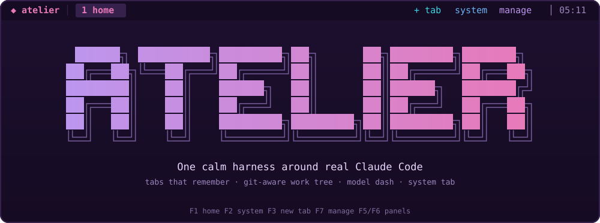
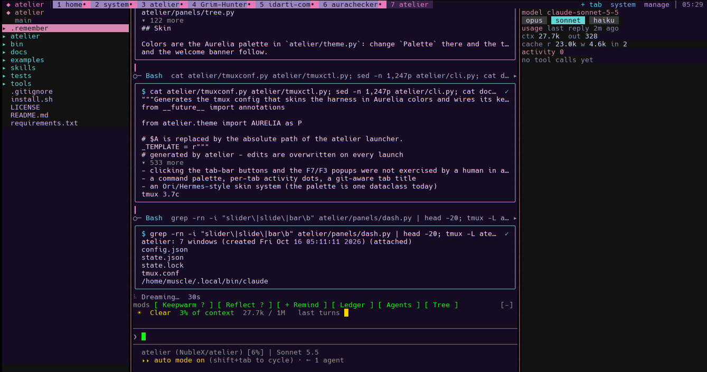
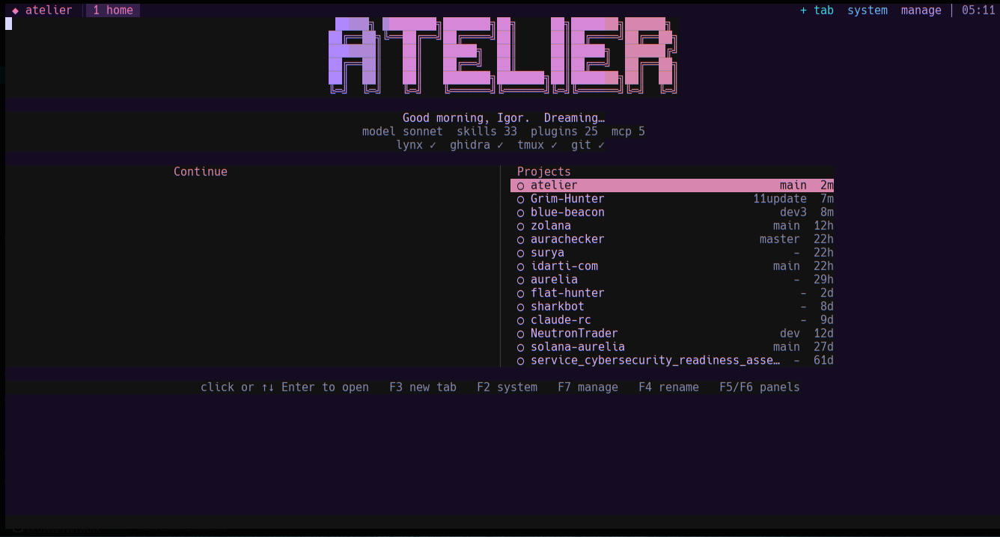
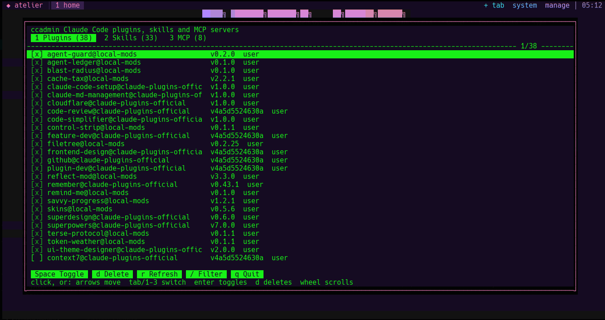
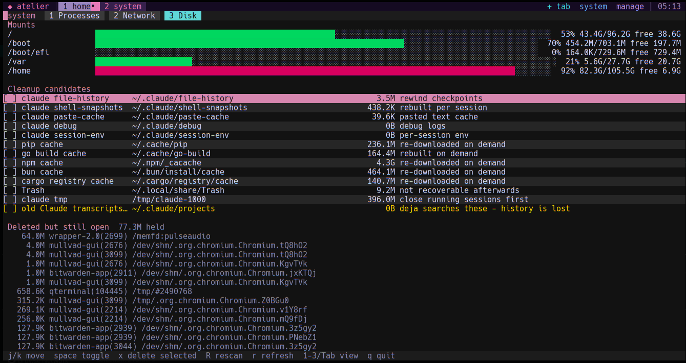

<p align="center">
  <a href="https://idarti.com"></a>
</p>

<p align="center">
  <a href="https://idarti.com"></a>
  <a href="https://idarti.com"></a>
  <a href="https://idarti.com"></a>
  <a href="https://idarti.com"></a>
  <a href="https://idarti.com"></a>
  <a href="https://idarti.com"></a>
  <a href="https://idarti.com"></a>
  <a href="https://idarti.com"></a>
  <a href="https://idarti.com"></a>
</p>

# atelier

One calm, Aurelia-skinned harness around real [Claude Code](https://claude.com/claude-code): a welcome screen,
tabs that remember your work, a git-aware work tree, a model and usage dash, a live feed of what Claude is
doing, a system tab, and a text browser the agents can use.

tmux hosts the terminals, so Claude Code runs exactly as it does anywhere else: your login, mods, hooks, skills
and MCP servers are untouched. atelier adds the frame around it and draws its own panels with Python.



## Screenshots

| Welcome | Manage (`ccadmin`) |
| --- | --- |
|  |  |



The side panels follow the window width; see Responsive below.

## Install

Requires Linux or macOS with `tmux` 3.4+ (developed and tested on 3.7c), Python 3.10+ expected (only 3.14 tested),
and `claude` on your PATH. `lynx` is optional (for `tbrowse`).

```
git clone https://github.com/NubleX/atelier.git && cd atelier
pip install -r requirements.txt      # prompt_toolkit, psutil (use a venv if your distro asks)
./install.sh                         # links atelier, tbrowse, ccadmin into ~/.local/bin
atelier
```

`./install.sh --skill` also links the `text-browser` skill into `~/.claude/skills` so Claude knows about `tbrowse`.

## Keys and mouse

| Key | Does |
| --- | --- |
| F1 | home (welcome screen) |
| F2 | system tab: processes, network, disk and cleanup |
| F3 | new tab (project picker) |
| F4 | rename this tab (also: double-click it) |
| F5 / F6 | hide or show the work tree / the dash panel |
| F7 | manage plugins, skills and MCP servers (`ccadmin`) |
| F8 | close this tab (asks first) |
| F9 | reset the panel widths |
| Alt+1..9 | jump to a tab |
| Ctrl+Space | tmux prefix for everything else |

Only F-keys and Alt+digits are taken, so Claude Code keeps its own Ctrl and other Alt shortcuts. The tab bar is
clickable; `tree`, `dash`, `+ tab`, `system` and `manage` at its right are buttons.

Drag a pane border to resize the work tree or dash. On release the width snaps to a preset (tree 20/30/40/50,
dash 32/44/60/80) when within 3 columns, otherwise it stays where you left it. Drag a panel narrower than 14
columns and it closes; the `tree` / `dash` buttons or F5 / F6 bring it back. Widths are remembered in
`~/.config/atelier/layout.json`.

Claude Code starts in its fullscreen mode (`CLAUDE_CODE_NO_FLICKER=1`), the only mode in which it reports mouse
clicks, so the buttons of your mods (the band above the prompt) respond. Scrolling then happens inside Claude
Code. Set `ATELIER_FULLSCREEN=0` to start it the old way.

## What is in it

- **Welcome**: gradient banner, greeting, your model, skill, plugin and MCP counts, which tools are installed,
  the tabs you can continue and your recent projects. Click or press Enter to open one. Put
  `{"name": "Ada"}` in `~/.config/atelier/config.json` to be greeted by name; otherwise it uses your login.
- **Tabs that remember**: each tab's name, folder and Claude session id are saved to
  `~/.config/atelier/state.json` on every change and every 15 seconds. The next `atelier` reopens them with
  `claude --resume`.
- **Work tree**: git status colors, branch and worktree count. Double-click or Enter on a file puts `@path` in
  Claude's prompt. A pink diamond marks files touched in the last 30 seconds.
- **Dash**: model buttons that send `/model <alias>`, token counts read from the transcript (no cost or
  context-window percentage: those numbers are not available to it), and a live feed of Claude's tool calls.
  Shell commands that use `tbrowse` or Ghidra's `analyzeHeadless` are tagged `[text-web]` and `[ghidra]`.
- **System tab**: processes with kill, network connections with throughput, disk bars, deleted-but-still-open
  files, and cleanup of an allowlist of caches. It never deletes outside the allowlist and never follows
  symlinks; old Claude transcripts are an opt-in row because history search depends on them.
- **`ccadmin`**: a mouse-and-keyboard manager for plugins, skills and MCP servers (enable, disable, remove).
- **`tbrowse`**: web pages and search as plain text through lynx. Fast, cheap on tokens, usable by subagents.

## Responsive

The work tree appears from 100 columns, the dash from 150. Narrower than that only Claude shows. Resize the
window and the panels follow.

## Skin

Colors are the Aurelia palette in `atelier/theme.py`: change `Palette` there and the tmux theme, every panel
and the welcome banner follow.

## Known limits

- A session is matched to a tab by the newest transcript in its folder, so two tabs in the same folder can swap
  sessions on restore.
- Developed on one machine. Other terminals, tmux versions and macOS are untested.
- Pages that need JavaScript, or that show a bot check, come back empty from `tbrowse`. It says what lynx got.

## Tests

```
python3 -m unittest discover -s tests -t .
```

The unit tests cover the transcript parser, the deletion-safety rules and the core helpers. The TUI itself was
checked by running it in a detached tmux and reading the screen with `capture-pane`; see
[docs/ARCHITECTURE.md](docs/ARCHITECTURE.md).

## More

- [docs/ARCHITECTURE.md](docs/ARCHITECTURE.md): how it works and why tmux is the engine
- [docs/SETUP-AUDIT.md](docs/SETUP-AUDIT.md): how a cluttered Claude Code setup was untangled, with the commands
- [examples/skill-library](examples/skill-library): the script that moved skills into a department layout

MIT licensed.
